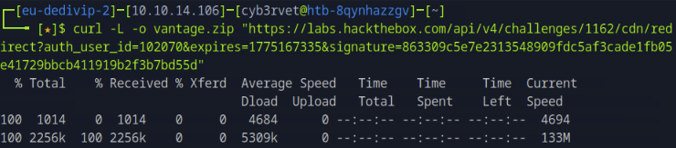
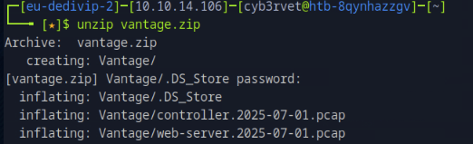
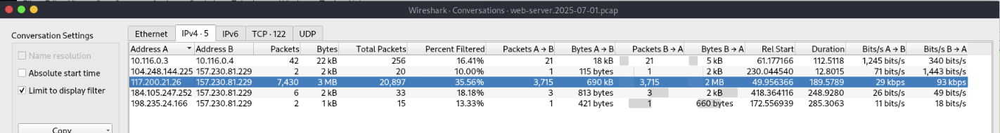
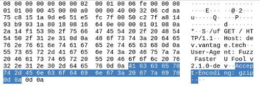
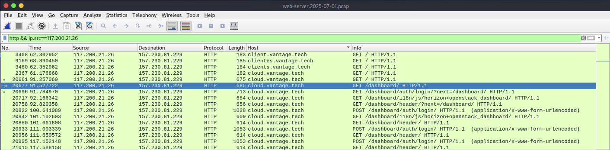
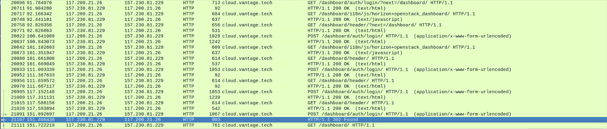
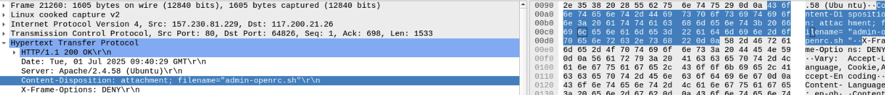

# Vantage Walkthrough                        


## Scenario

A small company moved some of its resources to a private cloud installation. The developers left the redirect to the dashboard on their web server. The security team got an email from the alleged attacker stating that the user data was leaked. It is up to you to investigate the situation.

### Artifacts Provided

Vantage.zip

### Tools Used

- Wireshark
- Curl
- Unzip

Let's first download the file with the curl command



Next we extract the contents of the file with unzip



We see two files
- ###### controller.2025-07-01.pcap
- ###### web-server.2025-07-01.pcap

Open the files using Wireshark.  We'll first take a look at the webserver pcap file. A few clues from the scenario.

1. Webserver
2. Redirect to the dashboard
3. Attacker stated the user data was leaked

Let's take a look at the questions

1. What tool did the attacker use to fuzz the web server ? (Format- include version e.g, [nmap@7.80](mailto:nmap@7.80))

###### ANSWER: ffuf@2.1.0

Other clues, fuzzing and web server. We know two protocols used for web servers (1) HTTP running at port 80 and (2) TLS (running at port 443). For now, I'm going t to filter with HTTP. 
I used the filter below in Wireshark:

```
http
```

We also looked at Statistics --> Conversations and notice form the IPv4 tap that there was a lot of traffic coming from IP address 117.200.21.26 going to 157.230.81.229 (must be the web server)




I'm going to narrow down my filtering to include the attacker's ip address using another filter

```
http && ip.src==117.200.21.26
```

That narrows down what we see, and notice User-Agent: Fuzz Faster U Fool v 2.1.0. A quick Google search reveals that that is ffuf.



2. Which subdomain did the attacker discover?

###### ANSWER: cloud

To make viewing easier as to what host the attacker discovered. From the lower left hand pane in Wireshark, expand Hypertext Transfer Protocol then highlight "Host" right-click then select "Apply as Column". The upper pane will look like this:




Also notice that there were a lot of POST on the cloud subdomain meaning the attacker was making input attempts against that subdomain.

3. How many login attempts did the attacker make before successfully logging in to the dashboard?
###### ANSWER: 3

Starting from the cloud.vantage.tech we see several POST request to login pages. Notice a HTTP 302 Found after 3 unsuccessful login attempts. This indicates a redirect to the user's dashboard.



4.  When did the attacker download the OpenStack API remote access config file? (UTC)

###### ANSWER: 2025-07-01 09:40:29




